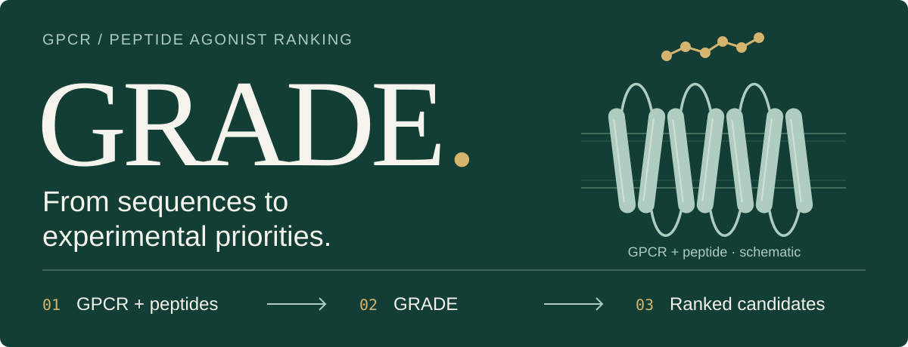

<picture>
  <source media="(max-width: 600px)" srcset="./assets/readme/grade-hero-mobile.svg">
  
</picture>

**GPCR-targeted Ranking-guided Agonist Design Engine**

GRADE ranks candidate peptides for predicted agonist activity at a target GPCR. Supply a GPCR amino acid sequence and a peptide list to receive scores sorted from highest to lowest for experimental prioritization.

[**Install**](#install) · [**Quick Start**](#quick-start) · [Agent Skill](#agent-skill) · [Local inference](#use-a-local-model) · [Cloud API](#cloud-api) · [Citation](#citation)

`grade-client` · Python 3.11+ · Model: **GRADE-paper** · [Preprint](https://doi.org/10.65215/LTSpreprints.2026.10.15.000361) · [MIT License](LICENSE)

## Install

Use Python 3.11 or newer. Create a virtual environment and install GRADE from PyPI:

```bash
python3 -m venv .venv
source .venv/bin/activate
python -m pip install "grade-client>=1.3.0"
```

<details>
<summary>Install from source</summary>

```bash
git clone https://github.com/devxia/GRADE.git
cd GRADE
python3 -m venv .venv
source .venv/bin/activate
python -m pip install .
```

</details>

## Quick Start

You can rank candidates in your browser at [grade.devxia.cc](https://grade.devxia.cc/).

To use the CLI, run `grade login` and open the page shown in your terminal. Follow the link sent to your email, then enter the terminal code in the browser to approve the device. The CLI session lasts up to 14 days. Use `grade whoami` to check it and `grade logout` to end it.

**1. Prepare your candidates**

Save this example as `candidates.fasta`:

```fasta
>peptide_1
ACDEFGHIKLMNPQRSTVWY
>peptide_2
YTVSRQPNMLKIHGFEDCA
```

**2. Rank against a target**

Run a prediction against the bundled human CCR5 target:

```bash
grade \
  --target-name CCR5_HUMAN \
  --peptides candidates.fasta \
  --output scores.csv
```

**3. Read the ranked results**

The output in `scores.csv` is sorted by descending score. These scores illustrate the format; they are not predictions for the example peptides:

```csv
rank,target,peptide_name,src,sequence,score
1,CCR5_HUMAN,peptide_1,grade-api,ACDEFGHIKLMNPQRSTVWY,0.82
2,CCR5_HUMAN,peptide_2,grade-api,YTVSRQPNMLKIHGFEDCA,0.31
```

Scores range from 0 to 1; higher scores indicate greater predicted agonist potential. Functional assays are needed to establish agonist activity. See [Inputs and result files](#inputs-and-result-files) for field definitions and interpretation.

Replace the example peptides with your candidates. For non-interactive use, sign in first with `grade login` on the machine that will run the prediction. Run `grade --help` for all command options.

### Use your own target

Save the complete amino acid sequence of your target in `target.fasta`, then run:

```bash
grade \
  --target-fasta target.fasta \
  --peptides candidates.fasta \
  --output scores.csv
```

If the target FASTA has several entries, add `--target-name` with the complete header of the desired entry. Each invocation scores one target. You may instead supply its amino acid sequence directly with `--target-seq`.

### Inputs and result files

<details>
<summary>Accepted target inputs and peptide file formats</summary>

| Target input | Arguments | Requirement |
|---|---|---|
| Bundled GPCR | `--target-name CCR5_HUMAN` | Exact header in the [bundled FASTA](grade/targets/targets_gpcr_v2.fa) |
| One sequence in a file | `--target-fasta target.fasta` | Exactly one FASTA entry |
| Selected entry in a file | `--target-fasta targets.fa --target-name CCR5_HUMAN` | Exact complete header in the supplied FASTA |
| Direct sequence | `--target-seq` followed by the amino acid sequence | Cannot be combined with other target arguments |

| Peptide format | Extensions | Contents |
|---|---|---|
| FASTA | `.fasta`, `.faa`, `.fa` | Full header becomes the candidate identifier |
| CSV | `.csv` | `sequence`, `peptide` or `seq` column; optional `name`, `peptide_name` or `id` |
| Text | `.txt` | One sequence per line, or whitespace-separated name and sequence |

</details>

Sequence whitespace is removed and letters are uppercased. Empty sequences and duplicate identifiers are rejected. Supply amino acid letters without residue numbers or chemical modification notation. Cloud encodes each target and peptide with a 1024-token limit, including special tokens; longer sequences are truncated.

Use the output extension to choose CSV, TSV or JSON. To keep only the highest-scoring candidates:

```bash
grade \
  --target-name CCR5_HUMAN \
  --peptides candidates.fasta \
  --top-k 20 \
  --output top20.json
```

`--output-format` overrides extension-based selection. An unrecognized extension defaults to CSV.

<details>
<summary>Output fields — CSV, TSV and JSON</summary>

The package writes the following fields; JSON output is an array with the same keys:

| Field | Meaning |
|---|---|
| `rank` | Descending-score rank, starting at 1 |
| `target` | Selected target header, or `custom_target` for a direct sequence |
| `peptide_name` | Candidate identifier |
| `src` | Source label; override with `--source-label` |
| `sequence` | Normalized candidate sequence |
| `score` | Positive-class softmax score from 0 to 1 |

</details>

Higher scores indicate greater predicted agonist potential for the target GPCR. The accompanying work treats scores above 0.9 as high-confidence candidates for experimental prioritization, not as a mandatory cutoff or calibrated probability of success. Functional assays are needed to establish agonist activity.

Results are checked before the output file is replaced. `grade-inference`, `python -m grade` and `python -m grade.inference` accept the same arguments as `grade`; `--output-csv` remains an alias for `--output`.

### Cloud quota

View the remaining daily prediction quota and reset time:

```bash
grade --usage
```

| Limit | Value |
|---|---|
| Peptides per request | Up to 50 |
| Predictions per email per UTC day | 50 |
| Predictions per client per UTC day | 50, counted independently |
| Effective available quota | Smaller of the two remaining balances |
| Reset time | UTC midnight; 08:00 Beijing time |

Website, CLI and Skill predictions count toward the same daily quota for a verified email. The CLI and Skill also share a client quota when they use the same login session. Repeated predictions count again, and `--top-k` does not reduce the number submitted. Users sharing a public IP do not share a daily quota.

If the service returns 429, follow the daily reset time or `Retry-After` value. A timed-out request may have consumed quota; check `grade --usage` before retrying.

## Agent Skill

The [GRADE Cloud Skill](skills/grade-cloud/SKILL.md) runs independently of the `grade-client` package. It needs Python and `requests`.

Install with Node.js and access to the GitHub repository:

```bash
npx skills add devxia/GRADE --skill grade-cloud
```

Alternatively, ask your agent:

> Install the grade-cloud skill from https://github.com/devxia/GRADE.

Example request:

> Use GRADE to rank the peptides in candidates.fasta against my GPCR target and save the results to scores.csv.

Provide the target sequence and candidate peptides. The Skill uses GRADE-paper and shares the verified login with the package.

The bundled script can also run directly from the cloned repository without installing `grade-client`:

```bash
python -m pip install requests
python skills/grade-cloud/scripts/grade_predict.py login
python skills/grade-cloud/scripts/grade_predict.py --help
```

Supply the target sequence with `--target-seq`, the candidate file with `--peptides`, and optionally an output path with `--output`. The script supports CSV, TSV, JSON and Top-K; it prints results to stdout when no output path is given. Its fields are `rank,peptide_name,sequence,score`.

## Use a local model

GRADE uses Cloud resources unless you specify a local model directory with `--model-dir`. Local inference requires no email and has no Cloud quota.

Install the local inference dependencies:

```bash
python -m pip install "grade-client[local]>=1.3.0"
```

For a source installation, run `python -m pip install ".[local]"` from the cloned `GRADE` directory instead.

Use Python 3.11 with PyTorch 2.4.0 and Transformers 4.44.0. A CUDA-enabled GPU is recommended for larger screens; CPU inference is also supported.

Specify your configured model directory:

```bash
grade \
  --model-dir /path/to/model \
  --target-name CCR5_HUMAN \
  --peptides candidates.fasta \
  --output local_scores.csv
```

Replace `/path/to/model` with your model directory. Local inference accepts the same [inputs and result formats](#inputs-and-result-files). The `src` field defaults to the candidate filename stem locally and `grade-api` for Cloud predictions.

Local requests remain on your machine. Errors do not trigger a fallback to Cloud. `--model-dir` cannot be combined with `--model`, which selects the Cloud model.

### GPU and multi-GPU inference

<details>
<summary>CUDA mixed precision and distributed inference examples</summary>

For CUDA mixed precision:

```bash
grade \
  --model-dir /path/to/model \
  --target-name CCR5_HUMAN \
  --peptides candidates.fasta \
  --output local_scores.csv \
  --batch-size 64 \
  --fp16
```

For four GPUs:

```bash
torchrun --nproc_per_node=4 --rdzv_backend=c10d --rdzv_endpoint=localhost:0 \
  -m grade.inference \
  --model-dir /path/to/model \
  --target-name CCR5_HUMAN \
  --peptides candidates.fasta \
  --output local_scores.csv \
  --batch-size 64 \
  --fp16
```

Batch size applies per process. Distributed execution requires an explicit local model directory. CPU users should omit mixed-precision flags.

</details>

### Local options and resume

Local runs save progress automatically. The default tokenizer limit is 1024 tokens; longer sequences are truncated.

<details>
<summary>Advanced local options and resume requirements</summary>

| Local-only option | Default | Purpose |
|---|---|---|
| `--batch-size` | 8 | Candidates per batch per process |
| `--num-workers` | 0 | Data-loading workers per process |
| `--max-length` | 1024 | Tokenizer maximum length; longer sequences are truncated |
| `--fp16` / `--bf16` | Off | CUDA mixed precision; choose at most one |
| `--attn-implementation` | `sdpa` | `eager`, `sdpa`, or `flash_attention_2`, subject to runtime support |
| `--checkpoint-interval` | 100 | Save progress every N batches |
| `--no-resume` | Off | Start fresh, replacing prior progress and output |
| `--no-target-cache` | Off | Disable target encoding reuse |

These options require `--model-dir`.

Resume with the same output path, model identity and resolved directory, target identifier/sequence, ordered candidate identifiers/sequences, effective source label, maximum length, process count, precision and attention settings. Changing the candidate filename can change its default source label. `--top-k` and output format may change when resuming. Incompatible progress files are rejected without replacing existing results; choose a new output path or explicitly use `--no-resume`.

</details>

## Cloud API

Base URL: `https://devxia--grade-web.modal.run`

The package and Skill handle these requests for most users. Direct integrations can use the same protocol:

| Endpoint | Request | Response |
|---|---|---|
| `POST /usage` | Bearer access token and JSON `{}` | `limit`, `remaining`, `reset_at` |
| `POST /predict` | Bearer access token and prediction JSON | Ranked predictions |

The [GRADE sign-in site](https://grade.devxia.cc/) issues access tokens after email verification. Send the token in `Authorization: Bearer <access_token>`. Cloud reads the verified email and client identity from the session.

<details>
<summary>Example prediction request for the bundled CCR5_HUMAN sequence</summary>

```json
{
  "model": "GRADE-paper",
  "target_seq": "MDYQVSSPIYDINYYTSEPCQKINVKQIAARLLPPLYSLVFIFGFVGNMLVILILINCKRLKSMTDIYLLNLAISDLFFLLTVPFWAHYAAAQWDFGNTMCQLLTGLYFIGFFSGIFFIILLTIDRYLAVVHAVFALKARTVTFGVVTSVITWVVAVFASLPGIIFTRSQKEGLHYTCSSHFPYSQYQFWKNFQTLKIVILGLVLPLLVMVICYSGILKTLLRCRNEKKRHRAVRLIFTIMIVYFLFWAPYNIVLLLNTFQEFFGLNNCSSSNRLDQAMQVTETLGMTHCCINPIIYAFVGEKFRNYLLVFFQKHIAKRFCKCCSIFQQEAPERASSVYTRSTGEQEISVGL",
  "peptides": [
    {"name": "peptide_1", "sequence": "ACDEFGHIKLMNPQRSTVWY"},
    {"name": "peptide_2", "sequence": "YTVSRQPNMLKIHGFEDCA"}
  ]
}
```

</details>

Omitting `model` selects GRADE-paper. Explicit null, empty or unsupported selections are rejected. Optional `format` is `json` (default), `csv` or `tsv`.

<details>
<summary>Response fields, headers and status codes</summary>

JSON responses contain `model`, `target`, `count` and descending-score `results`. Each result has `peptide_name`, `sequence` and `score`. The direct API labels its target `custom_target`; the package retains a locally resolved FASTA target name in its output. Direct CSV/TSV responses contain `rank,target,peptide_name,src,sequence,score`, with `src` set to `grade-api`.

Successful responses include `X-GRADE-Model`, `X-GRADE-Quota-Limit`, `X-GRADE-Quota-Remaining` and `X-GRADE-Quota-Reset`. The [Cloud quota](#cloud-quota) applies to every access method.

| Status | Meaning |
|---|---|
| 401 | Missing, invalid, expired or revoked access token |
| 422 | Invalid target, candidate list, request size, model or format |
| 429 | Daily quota or short-term frequency limit; follow reset/`Retry-After` |
| 500/503 | Server failure or uncertain outcome; check usage before retrying |

</details>

## Citation

If you use GRADE in your research, please cite:

> Xia, B. et al. Peptide agonist design from GPCR sequences. *LangTaoSha Preprint Server*, preprint (2026). <https://doi.org/10.65215/LTSpreprints.2026.10.15.000361>.

## License

The source code is licensed under the [MIT License](LICENSE).
